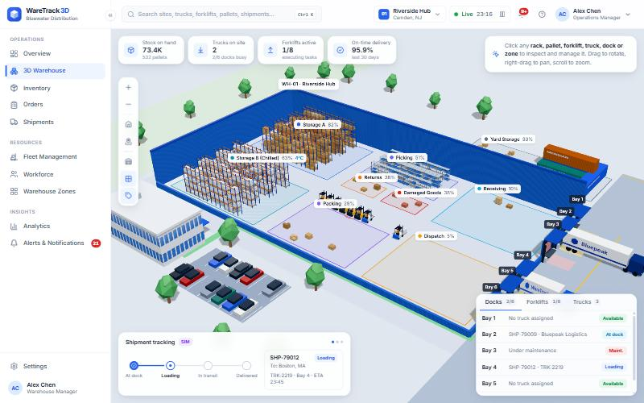
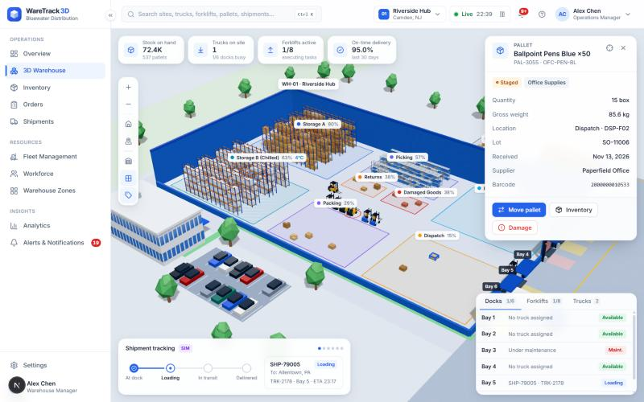
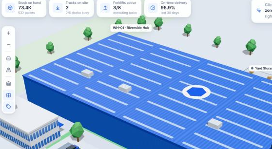
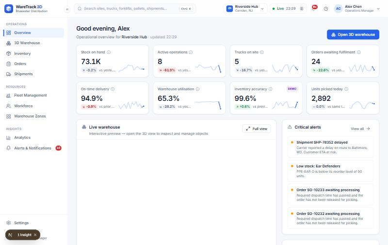
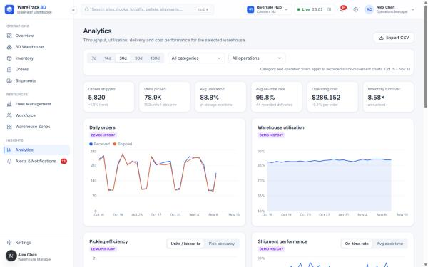

# WareTrack 3D

**Interactive 3D warehouse management and logistics simulation platform.**

WareTrack 3D combines a professional warehouse management system (inventory, orders, shipments, fleet, workforce, zones, analytics) with a live, isometric 3D model of the warehouse. You inspect and operate the site from the 3D view: click a pallet to move it, assign a forklift to a task, dock a truck, or close a zone. Every action is a real, validated, audited database change.

A deterministic demo simulation keeps the warehouse alive. Forklifts put away inbound pallets, trucks dock, load and depart, and orders flow from release to delivery. Everything the simulation creates is labelled **SIM**, so simulated activity is never confused with work done by real users.

> All companies, people and products in the demo data are fictional.

---

## Main features

| Area | What you can do |
| --- | --- |
| **3D Warehouse** | Procedural isometric scene built from database layout data: building with dock doors, cut-away/exterior views, racks, shelving, instanced pallets and cargo, forklifts, box trucks and carrier semis, office, car park, containers and trees. You can orbit, pan, zoom, reset, switch to top-down, and move the camera smoothly to an object. Clicking any rack, pallet, vehicle, dock or zone outlines it, pins it and opens an inspector with live data and actions. |
| **3D actions** | Move a pallet now or by forklift task, record damage, assign a task to a forklift, send a forklift to charge, put a vehicle into maintenance, assign a shipment and truck to a dock, open or close a dock, change zone status. |
| **Overview** | 8 KPI cards with comparisons and sparklines, a live 3D preview, critical alerts, zone occupancy, a performance chart, an activity feed, active shipments and pending orders. |
| **Inventory** | Product catalogue with SKU and barcode, categories, on-hand, reserved, available and damaged stock, reorder levels, zone locations and suppliers. Products can be created, edited, deleted (with archiving) and searched, filtered, sorted and paginated. Stock can be adjusted, transferred and recorded as damaged. Includes CSV export, low-stock alerts and movement history. |
| **Orders** | Status tabs, order creation with validated lines, and a workflow (pending → processing → picking → packing → ready → dispatched → delivered, or cancelled) with stock reservation and consumption, pick tasks, assignment to shipments, an order drawer and a timeline. |
| **Shipments** | Inbound and outbound shipments, a schematic route map (clearly labelled as simulated, not GPS), a status workflow, truck, driver and dock assignment, delay reporting and an event timeline. |
| **Fleet** | Forklifts, reach trucks, trucks and vans, each with status, operator, battery or fuel level, location, current assignment, maintenance log and service dates. Linked to the 3D view. |
| **Workforce** | Employee directory, profiles, roles, shifts, availability and aggregate performance indicators, plus assignment to tasks. No individual tracking or surveillance. |
| **Zones** | Floor plan and zone cards showing capacity, occupancy, operations, staff and temperature. Zones can be created, edited, deleted and have their status changed, and they render in the 3D scene. |
| **Analytics** | Range presets (7–180 days) and category and operation filters. Charts cover orders, utilisation, picking efficiency, shipment performance, stock movements, delivery performance, costs, turnover and categories. Each chart is labelled **DEMO HISTORY** or **RECORDED DATA**. Includes CSV export. |
| **Alerts** | Notification centre with read/unread state, categories, priorities and history, plus a full activity log split into user actions and simulated events. |
| **Settings** | Profile, password, preferences (default warehouse, muted alert categories), warehouse configuration and simulation control, users and roles (admin only), a permissions matrix and the audit log. |

### Roles

| Role | Access |
| --- | --- |
| Administrator | Everything, including user management |
| Warehouse Manager | Operations plus catalogue, zones, fleet, workforce, simulation, warehouse settings and the audit log |
| Operator | Read access plus stock moves, tasks, order/shipment status updates and forklift assignment |
| Viewer | Read-only |

Permissions are enforced **on the server** for every API route (`src/server/api/handler.ts`). The UI only hides controls a user cannot use.

---

## Technology stack

- **Next.js 16** (App Router, Turbopack, Cache Components), **React 19**, **TypeScript**
- **Tailwind CSS 4** with shadcn-style components on **Radix UI**, plus **Lucide** icons
- **Three.js**, **React Three Fiber** and **Drei** for the 3D scene, with procedural geometry and canvas textures (no external assets)
- **Zustand** for UI and scene state, and **TanStack Query** for server state
- **Recharts** for charts
- **PostgreSQL** with **Prisma 7** (driver adapter `@prisma/adapter-pg`), migrations and a deterministic seed
- **Zod** and **React Hook Form** for validation
- Custom database-backed sessions: bcrypt password hashes, httpOnly cookies, SHA-256 token hashes, rate-limited sign-in
- **Vitest** for unit, integration, API and journey tests
- Docker and a Render Blueprint for deployment

---

## Screenshots

**3D warehouse: cut-away view with live KPIs, dock and fleet panels and shipment tracking**



**Selecting a pallet opens the inspector with move, inventory and damage actions**



**Exterior view (roof on)**



**Overview dashboard**



**Analytics**



---

## Getting started

### Prerequisites

- Node.js **20.19+** (22 recommended)
- Docker (for the local PostgreSQL), or any PostgreSQL 15+ instance

### Installation

```bash
git clone <your-repo-url> waretrack-3d
cd waretrack-3d
cp .env.example .env          # adjust if needed
docker compose up -d          # PostgreSQL on localhost:5433 (+ waretrack_test database)
npm install                   # also generates the Prisma client
npm run db:deploy             # apply migrations
npm run db:seed               # load demo data (~5 s)
npm run dev                   # http://localhost:3000
```

Sign in with one of the demo accounts. The password is the `SEED_DEMO_PASSWORD` value from your `.env`.

| Email | Role |
| --- | --- |
| `admin@waretrack.demo` | Administrator |
| `manager@waretrack.demo` | Warehouse Manager |
| `operator@waretrack.demo` | Operator |
| `viewer@waretrack.demo` | Viewer |

> On npm 11+, if `npm install` reports blocked install scripts, run `npm install-scripts approve @prisma/engines esbuild` and then `npm rebuild`.

### Environment configuration

| Variable | Purpose |
| --- | --- |
| `DATABASE_URL` | PostgreSQL connection string |
| `DATABASE_SCHEMA` | Optional Postgres schema for all tables (for shared databases) |
| `TEST_DATABASE_URL` | Separate database for the test suite (**wiped by tests**) |
| `SESSION_TTL_HOURS` | Session lifetime (default 12) |
| `NEXT_PUBLIC_DEMO_MODE` | Shows the demo-account helper on the sign-in page |
| `SEED_DEMO_PASSWORD` | Password for the seeded demo users |
| `SEED_DEMO_DATA` | Set `false` to skip demo data on first deploy |

No paid external services are required. The application runs entirely on its own database.

### Development commands

| Command | Description |
| --- | --- |
| `npm run dev` | Start the dev server |
| `npm run build` / `npm start` | Production build / serve |
| `npm run typecheck` | TypeScript check |
| `npm run lint` | ESLint |
| `npm test` | Vitest suite (unit + integration; needs `TEST_DATABASE_URL`) |
| `npm run check` | Typecheck, lint and test |
| `npm run db:migrate` | Create/apply a migration in development |
| `npm run db:seed` | Reset and reseed demo data |
| `npm run db:studio` | Prisma Studio |
| `npm run sim:run -- WH-01 30` | Run 30 simulation ticks from the CLI |

---

## Deployment

The repository includes a **Render Blueprint** (`render.yaml`) and a **Dockerfile**. See [DEPLOYMENT.md](./DEPLOYMENT.md) for step-by-step instructions, environment variables, migrations, seeding and the health check (`/api/health`).

---

## Project documentation

- [INSTRUCTIONS.md](./INSTRUCTIONS.md): user guide covering how to operate the warehouse
- [DEPLOYMENT.md](./DEPLOYMENT.md): production deployment
- [CLAUDE.md](./CLAUDE.md): architecture and conventions for contributors and AI agents
- [DEVELOPMENT_CHECKLIST.md](./DEVELOPMENT_CHECKLIST.md): phase checklist and known limitations
